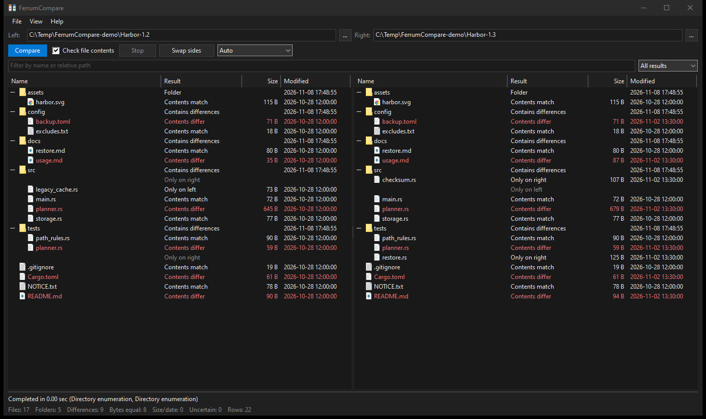
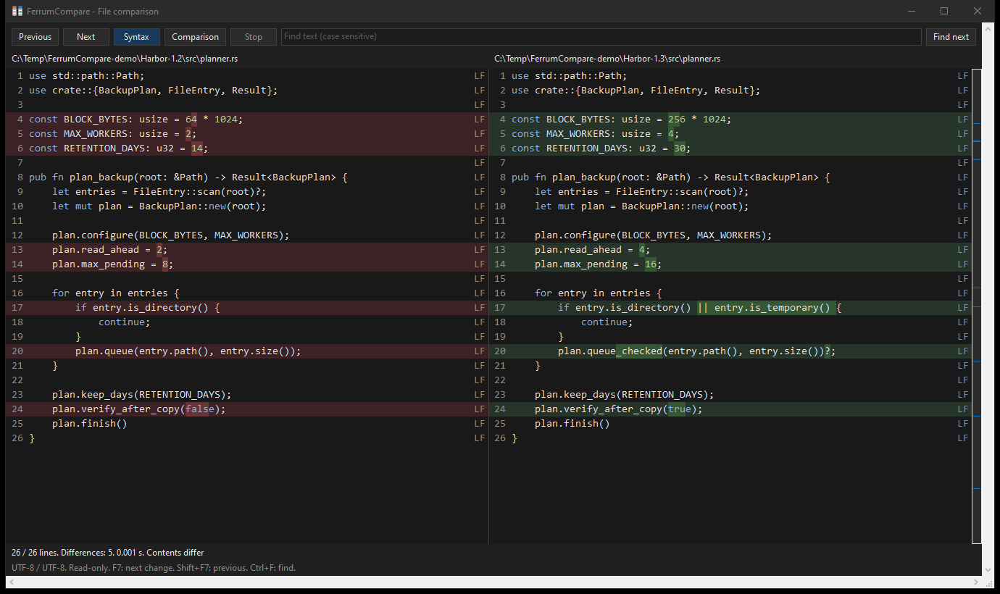

# FerrumCompare

[](https://github.com/dyrb/ferrumcompare/actions/workflows/ci.yml)
[](https://github.com/dyrb/ferrumcompare/releases/latest)
[](#license)


Folder and text comparison for Windows. Compare two project versions, check a backup,
or inspect changes in source files with a side-by-side view, syntax highlighting and
individual changes marked within each line. Written in Rust with a native Win32 interface.

[Русская версия](README.ru.md)



## Features

- Side-by-side folder trees with aligned paths, sizes, modification times and comparison
  results. Find changed files and items present on only one side.
- Quick comparison by size and date, or parallel byte comparison with **Check file
  contents**. Verified matches are distinguished from metadata matches.
- Directory enumeration for local folders and network shares; optional direct NTFS MFT
  enumeration. Automatic mode uses the MFT for volume roots when access is available.
- Include masks such as `*.cpp;*.hpp` and directory exclusions such as `.git;.vs;target;build`.
  Separate display filters let you hide results without changing the analysis scope.
- Text comparison with aligned source line numbers, syntax highlighting and separate
  highlights for multiple changes within a line.
- Independent options for spaces, tabs, blank lines, case and line endings. Ignored
  differences produce **Matches with comparison settings**, distinct from an exact match.
- Change overview, previous/next difference, folding of unchanged regions, text search,
  go to line, selection and copying from either side.
- UTF-8, UTF-16 LE/BE and Windows-1251, with independent encoding selection for each file.
- Virtual text view: only visible text is loaded for display. Text indexing and alignment
  have explicit memory and work budgets; operations can be cancelled.
- Drag and drop one file or folder per side, or two items together. Export folder results
  to CSV or JSON; use the CLI for unified text diff output and scripts.
- Light and dark themes, system theme support, English and Russian interface.
- Portable GUI and CLI. Settings are stored in `FerrumCompare.ini` beside the executable.



The screenshots compare two versions of Harbor, a fictional backup project. They show
changes to buffer sizes, worker counts, retention and verification, alongside added and
removed source files.

## Usage

Download the ZIP from [Releases](https://github.com/dyrb/ferrumcompare/releases), extract it
and run `ferrumcompare-gui.exe`. Requires Windows 10 or 11, x64. Normal folder and text
comparison does not require administrator rights; direct MFT access requires elevation.

Choose a source on each side and press **Compare**, or drop files or folders onto the
window. Enable **Check file contents** to verify bytes rather than relying on size and
date. Double-click a file in the results to open its text comparison.

**View > Analysis filters** controls what is scanned. The search field and result selector
filter what is displayed. For example, `*.rs;*.toml;!generated*` shows matching names and
hides names beginning with `generated`.

In the text window, **Comparison** contains text rules, folding and per-side encodings.
Click the overview strip to jump through the file, or click a folded region to expand it.
Select the language and theme in the main window's **View** menu.

| Key | Action |
| --- | --- |
| F5 | Compare folders |
| Escape | Cancel the current comparison; close an idle text window |
| Enter / double-click | Open a file or expand a folder in the results |
| Space | Expand or collapse the selected folder |
| F7 / Shift+F7 | Next / previous difference in text |
| Ctrl+F | Find text |
| F3 | Find the next occurrence |
| Ctrl+G | Go to a source line in the active text pane |
| Ctrl+A / Ctrl+C | Select all / copy in the active text pane |

### Command line

```powershell
# Verify the contents of two folder trees.
.\ferrumcompare.exe C:\Projects\before C:\Projects\after --contents

# Compare source files, excluding build folders, and save a JSON report.
.\ferrumcompare.exe C:\Projects\before C:\Projects\after --contents --include '*.cpp;*.hpp' --exclude '.git;build' --json --output C:\Reports\comparison.json

# Compare text, ignoring CRLF/LF differences, with inline change ranges.
.\ferrumcompare.exe C:\Projects\before\planner.rs C:\Projects\after\planner.rs --ignore-crlf --inline

# Decode an older Windows-1251 file and a UTF-8 file independently.
.\ferrumcompare.exe C:\Projects\before\legacy.cpp C:\Projects\after\legacy.cpp --encoding-left windows1251 --encoding-right utf8
```

Run `ferrumcompare.exe --help` for all options. Exit codes: `0` match under the selected
comparison, `1` differences, `2` error or uncertain results, `130` cancelled. A report must
be a new file outside both compared roots; its parent folder must already exist.

## Building from source

1. Install [Build Tools for Visual Studio](https://visualstudio.microsoft.com/visual-cpp-build-tools/)
   with **Desktop development with C++**, including the Windows SDK and MSVC linker.
2. Install Rust through [rustup.rs](https://rustup.rs), using the MSVC toolchain. Rust 1.88
   or newer is required.
3. Download the source ZIP or clone this repository, then run in its folder:

   ```powershell
   cargo build --release --workspace --locked
   ```

The executables are `target\release\ferrumcompare-gui.exe` and
`target\release\ferrumcompare.exe`. The only external crates are `windows-sys` and its
`windows-link` dependency; Windows draws the interface directly.

`scripts\build-release.ps1` builds the executables and creates a ZIP with a SHA-256
checksum in `dist`. Personal settings and build artifacts are excluded from the archive.

Checks:

```powershell
cargo fmt --all --check
cargo clippy --workspace --all-targets --locked -- -D warnings
cargo test --workspace --locked
```

## Comparison details

Sources are opened read-only. Folder content checks compare the main file stream;
reparse points are compared without traversal. ACLs and alternate data streams are outside
the comparison scope. Extract archives before comparing their contents.

Automatic text detection accepts UTF-8 and BOM-declared UTF-16. Choose Windows-1251 or
BOMless UTF-16 manually. Encoding, BOM and a missing final newline remain significant.
Case ignoring uses Unicode lowercase mappings. When complex input exceeds alignment or
highlighting budgets, the viewer reports the coarser result; it does not truncate the file.
Copying a selection larger than 64 MiB reports an error rather than returning partial text.

## Credits

Developed by [dyrb](https://github.com/dyrb), with contributions from Claude and Codex.
Based on [FerrumTree](https://github.com/dyrb/ferrumtree), reusing its NTFS reader and
native Windows interface foundation.

## License

Licensed under either [Apache License 2.0](LICENSE-APACHE) or [MIT](LICENSE-MIT), at your option.
