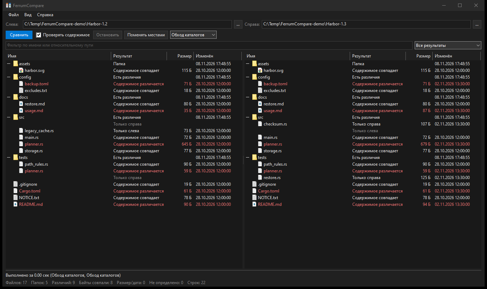
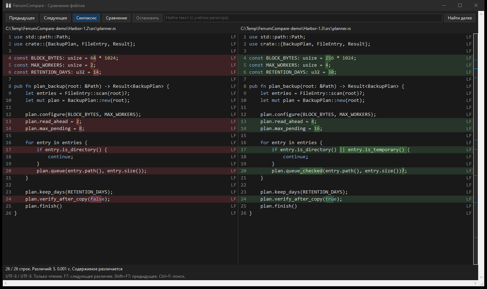

# FerrumCompare

[](https://github.com/dyrb/ferrumcompare/actions/workflows/ci.yml)
[](https://github.com/dyrb/ferrumcompare/releases/latest)
[](#лицензия)


Сравнение папок и текста для Windows. Сопоставляйте версии проектов, проверяйте резервные
копии и изучайте изменения исходного кода в двух панелях, с подсветкой синтаксиса и
отдельных изменений внутри строк. Написано на Rust с нативным интерфейсом Win32.

[English version](README.md)



## Возможности

- Два дерева папок с выровненными путями, размерами, датами изменения и результатами
  сравнения. Поиск изменённых файлов и объектов, которые есть только с одной стороны.
- Быстрое сравнение по размеру и дате или параллельная побайтовая проверка с настройкой
  **Проверять содержимое**. Проверенные совпадения отличаются от совпадений метаданных.
- Обход локальных и сетевых папок, а также прямое чтение NTFS MFT. Автоматический режим
  использует MFT при сравнении корней томов, если доступ разрешён.
- Маски включения, например `*.cpp;*.hpp`, и исключения папок, например `.git;.vs;target;build`.
  Отдельные фильтры отображения скрывают результаты, не меняя область анализа.
- Построчное сравнение текста с исходными номерами строк, подсветкой синтаксиса и
  раздельным выделением нескольких изменений внутри одной строки.
- Независимые настройки пробелов, табуляции, пустых строк, регистра и окончаний строк.
  Для совпадения с исключениями используется результат **Совпадают с учётом настроек**.
- Карта различий, переход между изменениями, сворачивание одинаковых участков, поиск,
  переход к строке, выделение и копирование текста с любой стороны.
- UTF-8, UTF-16 LE/BE и Windows-1251 с отдельным выбором кодировки для каждого файла.
- Виртуальное отображение текста: для отрисовки загружается только видимая область.
  Индексация и сопоставление ограничены бюджетами памяти и вычислений; операции отменяются.
- Перетаскивание файла или папки на каждую сторону либо двух объектов одновременно.
  Экспорт результатов сравнения папок в CSV и JSON, CLI с выводом построчных различий.
- Светлая, тёмная и системная темы, русский и английский интерфейс.
- Портативные GUI и CLI. Настройки хранятся в `FerrumCompare.ini` рядом с программой.



На скриншотах сравниваются две версии вымышленного проекта резервного копирования Harbor.
Показаны изменения размеров буфера, числа рабочих потоков, срока хранения и проверки
копий, а также добавленные и удалённые исходные файлы.

## Использование

Скачайте ZIP из [Releases](https://github.com/dyrb/ferrumcompare/releases), распакуйте
и запустите `ferrumcompare-gui.exe`. Требуется Windows 10 или 11, x64. Обычное сравнение
папок и текста работает без прав администратора; прямое чтение MFT требует повышения прав.

Выберите источник с каждой стороны и нажмите **Сравнить** или перетащите файлы либо папки
в окно. Включите **Проверять содержимое**, чтобы сравнивать байты, а не только размер и дату.
Двойной щелчок по файлу в результатах открывает сравнение его текста.

**Вид > Фильтры анализа** определяет, что будет прочитано. Поле поиска и переключатель
результатов меняют только отображение. Например, `*.rs;*.toml;!generated*` показывает
подходящие имена и скрывает имена, начинающиеся с `generated`.

В окне текста меню **Сравнение** содержит настройки текста, сворачивание и кодировки
обеих сторон. Нажатие на карту переносит к участку файла, на свёрнутую область раскрывает
её. Язык и тема выбираются в меню **Вид** главного окна.

| Клавиша | Действие |
| --- | --- |
| F5 | Сравнить папки |
| Escape | Отменить текущее сравнение; закрыть окно текста после завершения |
| Enter / двойной щелчок | Открыть файл или раскрыть папку в результатах |
| Пробел | Раскрыть или свернуть выбранную папку |
| F7 / Shift+F7 | Следующее / предыдущее различие в тексте |
| Ctrl+F | Найти текст |
| F3 | Найти следующее вхождение |
| Ctrl+G | Перейти к исходной строке в активной панели текста |
| Ctrl+A / Ctrl+C | Выделить всё / скопировать в активной панели текста |

### Командная строка

```powershell
# Проверить содержимое двух деревьев папок.
.\ferrumcompare.exe C:\Projects\before C:\Projects\after --contents

# Сравнить исходники, исключить сборочные папки и сохранить JSON-отчёт.
.\ferrumcompare.exe C:\Projects\before C:\Projects\after --contents --include '*.cpp;*.hpp' --exclude '.git;build' --json --output C:\Reports\comparison.json

# Сравнить текст без различий CRLF/LF, показать диапазоны изменений внутри строк.
.\ferrumcompare.exe C:\Projects\before\planner.rs C:\Projects\after\planner.rs --ignore-crlf --inline

# Прочитать старый файл в Windows-1251 и новый в UTF-8.
.\ferrumcompare.exe C:\Projects\before\legacy.cpp C:\Projects\after\legacy.cpp --encoding-left windows1251 --encoding-right utf8
```

Все параметры: `ferrumcompare.exe --help`. Коды завершения: `0` совпадение в выбранном
режиме, `1` различия, `2` ошибка или неопределённый результат, `130` отмена. Отчёт сохраняется
в новый файл за пределами обеих сравниваемых папок; папка для отчёта должна существовать.

## Сборка из исходного кода

1. Установите [Build Tools for Visual Studio](https://visualstudio.microsoft.com/visual-cpp-build-tools/)
   с набором **Разработка классических приложений на C++**, включая Windows SDK и MSVC.
2. Установите Rust через [rustup.rs](https://rustup.rs) с инструментами MSVC. Требуется
   Rust 1.88 или новее.
3. Скачайте ZIP исходников или клонируйте репозиторий и выполните в его папке:

   ```powershell
   cargo build --release --workspace --locked
   ```

Программы появятся в `target\release\ferrumcompare-gui.exe` и
`target\release\ferrumcompare.exe`. Внешние crates: только `windows-sys` и его зависимость
`windows-link`. Интерфейс отрисовывается средствами Windows.

`scripts\build-release.ps1` собирает программы и создаёт ZIP с контрольной суммой SHA-256
в `dist`. Личные настройки и промежуточные файлы сборки в архив не включаются.

Проверки:

```powershell
cargo fmt --all --check
cargo clippy --workspace --all-targets --locked -- -D warnings
cargo test --workspace --locked
```

## Особенности сравнения

Источники открываются только для чтения. Побайтовая проверка папок сравнивает основной
поток данных файла; точки повторного анализа сравниваются без перехода по ним. Права
доступа и альтернативные потоки не входят в сравнение. Архивы предварительно распакуйте.

Автоматически распознаются UTF-8 и UTF-16 с BOM. Windows-1251 и UTF-16 без BOM выбираются
вручную. Кодировка, BOM и отсутствие последнего перевода строки остаются значимыми.
Игнорирование регистра использует преобразование Unicode в нижний регистр. При превышении
бюджета сопоставления или подсветки программа сообщает об упрощённом результате, не
обрезая файл. Копирование выделения больше 64 МиБ завершается ошибкой без частичного текста.

## Авторы

Разработчик: [dyrb](https://github.com/dyrb), при участии Claude и Codex.
Основано на [FerrumTree](https://github.com/dyrb/ferrumtree): используются его модуль чтения
NTFS и основа нативного интерфейса Windows.

## Лицензия

На выбор: [Apache License 2.0](LICENSE-APACHE) или [MIT](LICENSE-MIT).
